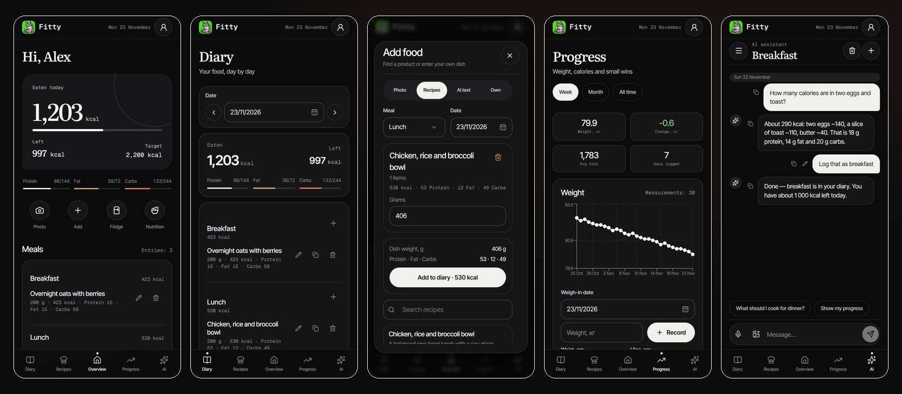

<p align="center">
  
</p>

<h1 align="center">Fitty — an AI food diary in Telegram</h1>

<p align="center">
  <b>Eat well. Let AI do the counting.<br>
  Photo, voice or text in — calories, macros and recipes out.</b>
</p>

<p align="center">
  <a href="https://t.me/AiFittyBot"><b>Open in Telegram</b></a>
  &nbsp;·&nbsp;
  <a href="https://ivanburenin.github.io/fitty-ai/">Landing page</a>
  &nbsp;·&nbsp;
  <a href="https://github.com/IvanBurenin">GitHub profile</a>
</p>

<p align="center">
  
</p>

## What is Fitty

Fitty is a Telegram bot with a Mini App for people who want to eat well without
turning every meal into a spreadsheet. It opens inside Telegram: nothing to
install, no separate account, no noisy feed.

Snap a plate, type a sentence, or say it out loud. Fitty estimates calories and
macros, keeps a calm diary, answers questions about your day, and turns whatever
is already in the fridge into dinner.

## What it does

### Food diary
- Breakfast, lunch, dinner and snacks with portions, calories and macros.
- Edit, duplicate or move an entry when plans change.
- A day view with calories left and macro progress.

### Four ways to log
- **Photo** — AI recognises the dish and estimates the portion.
- **Recipes** — pick a saved recipe, adjust grams and add it to the day.
- **AI text** — describe the meal in plain language.
- **Your own dish** — enter the name, grams and macros manually.

### AI assistant
- Logs food from a sentence: "two eggs and toast".
- Suggests meals that fit the remaining calories.
- Builds recipes from fridge ingredients.
- Answers questions about calories, macros and progress.
- Keeps a shared chat history between the bot and the Mini App.

### Recipes & fridge
- AI recipe generator for a dish, diet or set of ingredients.
- Fridge mode: add what you have and get a recipe.
- A shelf of saved recipes with per-portion and per-100 g nutrition.
- One tap to add a portion to the diary.

### Targets & progress
- Personal calorie and macro plan based on goal, body and pace.
- Recalculates when weight or the goal changes.
- Weight chart, average calories and diary days for a week, month or all time.
- No leaderboards, no streak guilt.

### Six languages
English, Russian, German, French, Spanish and Chinese — in the Mini App, the
bot and the landing page.

## This repository

```
.
├── docs/               screenshots used by the README
├── landing/            React + Vite landing page
│   ├── public/         app icon, screenshots, social preview
│   └── src/            page, content, styles
└── gh-pages            built landing (published by GitHub Pages)
```

The landing is published on GitHub Pages from the `gh-pages` branch:
**https://ivanburenin.github.io/fitty-ai/**

### Run the landing locally

```bash
cd landing
npm install
npm run dev
```

Open `http://localhost:5174`.

### Publish

```bash
cd landing
npm run build -- --base=/fitty-ai/
# copy landing/dist to the gh-pages branch and push
```

---

<p align="center">
  <a href="https://t.me/AiFittyBot"><b>Open Fitty in Telegram →</b></a>
</p>
