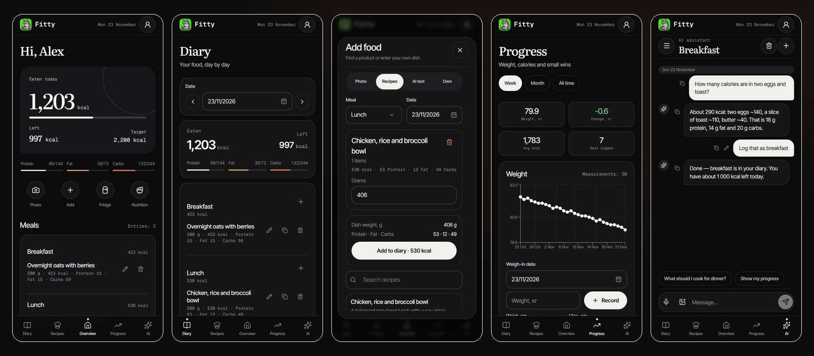
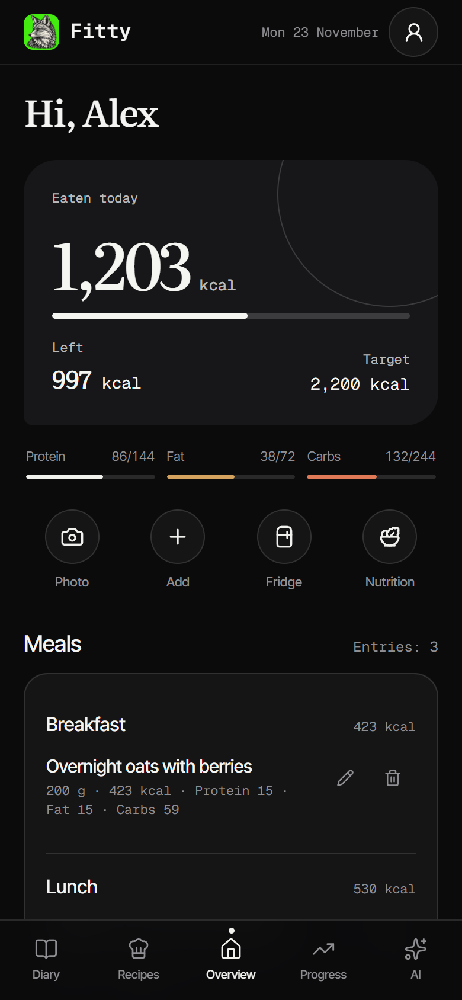
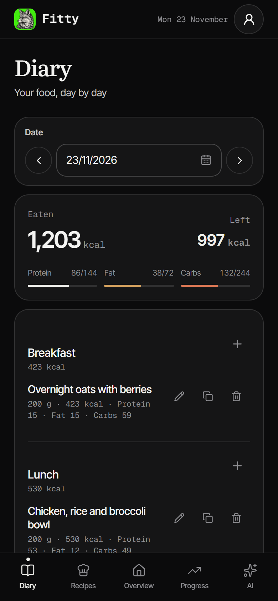
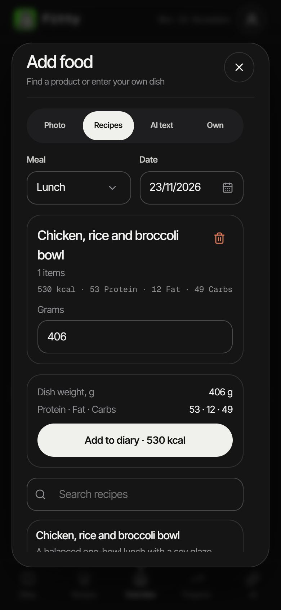
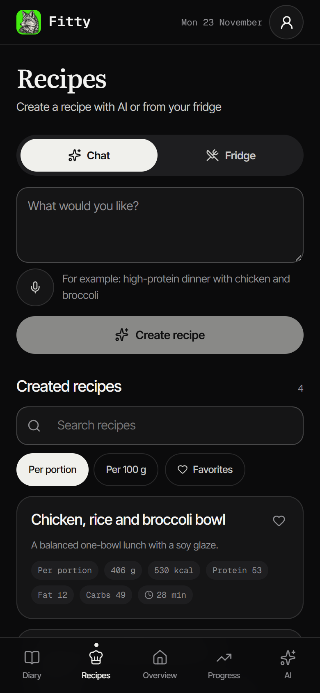
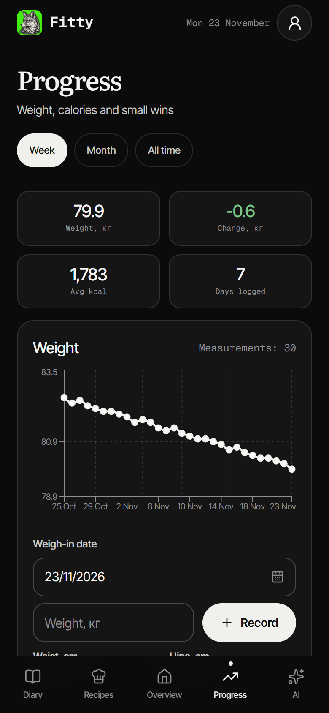
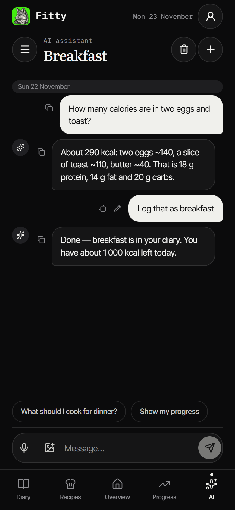

<p align="center">
  
</p>

<h1 align="center">Fitty — an AI food diary in Telegram</h1>

<p align="center">
  <b>Eat well. Let AI do the counting.<br>
  Photo, voice or text in — calories, macros and recipes out.</b>
</p>

<p align="center">
  <a href="https://t.me/AiFittyBot"><b>Open in Telegram</b></a>
  &nbsp;·&nbsp;
  <a href="https://ivanburenin.github.io/fitty-ai/">Landing page</a>
  &nbsp;·&nbsp;
  <a href="https://github.com/IvanBurenin/fitty-ai">Public showcase</a>
</p>

<p align="center">
  
</p>

This folder contains the source of the landing page for **Fitty**, a Telegram
bot and Mini App for food logging without the spreadsheet. The page is built
with React 18, TypeScript and Vite, is English by default, and switches between
all six product languages. It is published on GitHub Pages from the separate
public repository [`fitty-ai`](https://github.com/IvanBurenin/fitty-ai).

## What the product does

- **Food diary** — breakfast, lunch, dinner and snacks with portions, calories
  and macros. Edit, duplicate or move an entry when plans change.
- **Four ways to log** — a photo, a recipe, AI text or your own dish with grams.
- **Photo recognition** — AI estimates the dish, portion and macros; you confirm
  before anything is written to the diary.
- **AI assistant** — logs food in plain language, suggests a meal for the
  remaining calories and builds recipes from fridge ingredients.
- **Recipes** — an AI recipe generator, a fridge mode, saved recipes and
  one-tap portion logging.
- **Targets** — a personal calorie and macro plan that recalculates when weight
  or the goal changes.
- **Progress** — weight chart, average calories and diary days for a week, month
  or all time. No leaderboards.
- **Six languages** — English, Russian, German, French, Spanish and Chinese.

## Languages

The landing page switches between the same six languages as the Mini App. The
choice is saved in `localStorage`, can be shared with `?lang=ru`, and updates the
page copy, screenshots, `<html lang>`, title, description and Open Graph locale.

Screenshots for each language live in `public/screens/<lang>/`.

## Screens

| Overview | Diary | Add food |
|:---:|:---:|:---:|
|  |  |  |
| **Recipes** | **Progress** | **AI assistant** |
|  |  |  |

## Run locally

```bash
cd landing
npm install
npm run dev
```

Open `http://localhost:5174`.

## Build

```bash
cd landing
npm run build -- --base=/fitty-ai/
```

The output is written to `landing/dist`.

## Publish

The GitHub Pages site is built from the `gh-pages` branch of
`IvanBurenin/fitty-ai`. To update it, build with the base path above, copy
`landing/dist` into a clean `gh-pages` branch and push it.

The public repository mirrors this folder in `landing/`, keeps the README and
`docs/screens.png`, and serves the built page from `gh-pages`.
